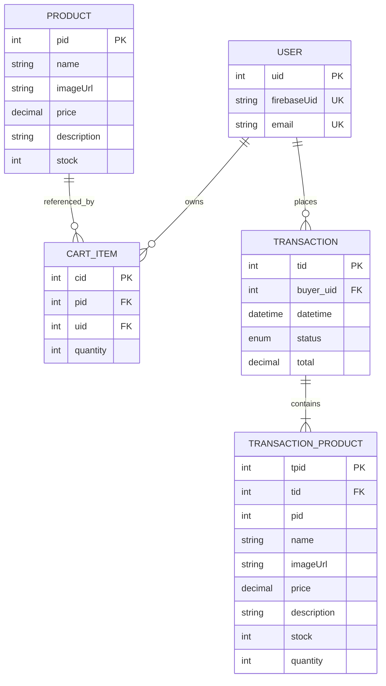
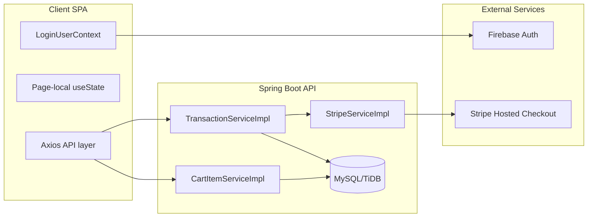
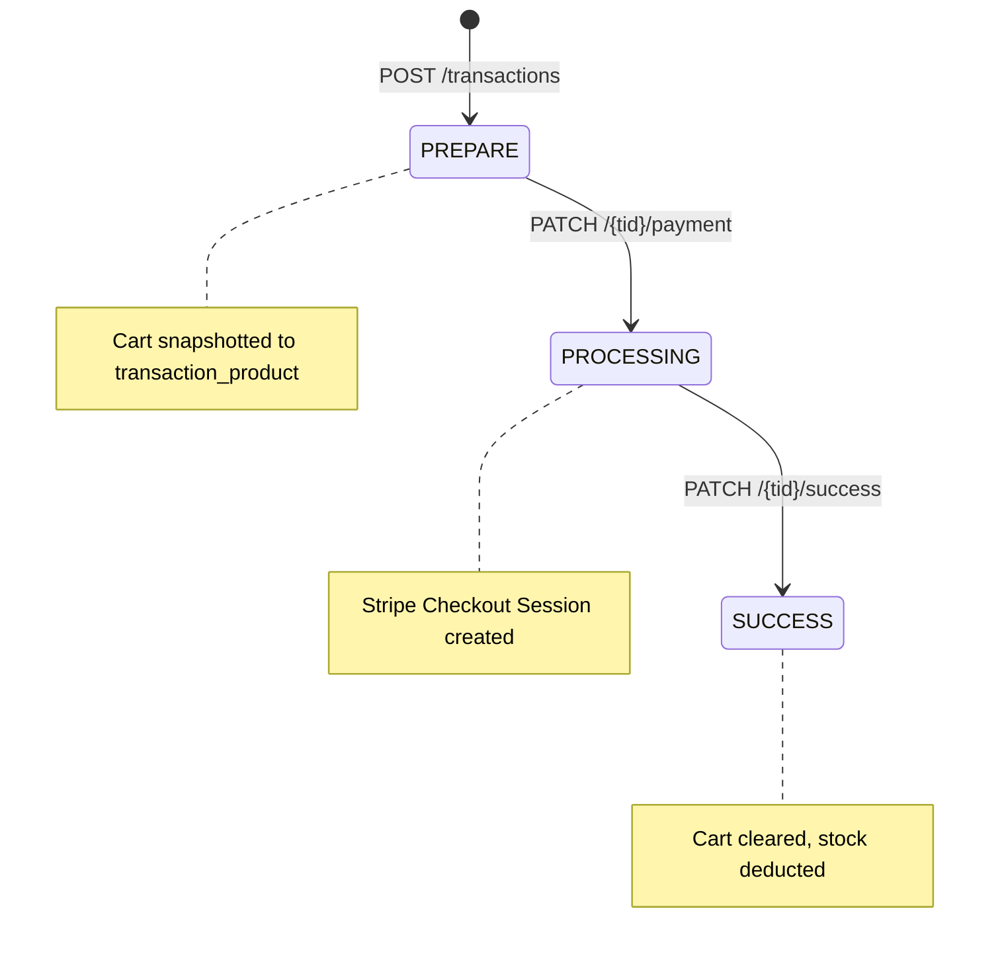
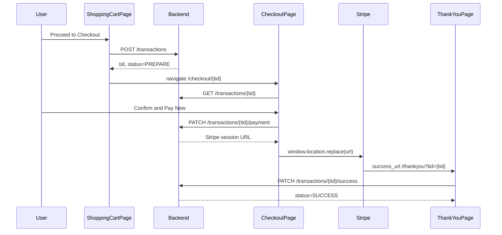
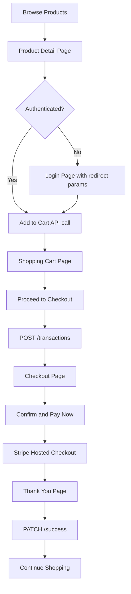

# Technical Specification Document

## FSSE2602 Pokémon TCG E-Commerce Platform

| Field | Value |
|-------|-------|
| **Version** | 1.0.0 |
| **Date** | 2026-09-16 |
| **Status** | As-Implemented |
| **Frontend Repository** | `fsse2602_project_frontend-master` |
| **Backend Repository** | `fsse2602_backend_project` |
| **Author** | Architecture Review (Cloud Agent) |

---

## Executive Summary

This document describes the technical architecture of the FSSE2602 Pokémon TCG e-commerce platform as implemented across two repositories: a React single-page application (SPA) frontend and a Spring Boot REST API backend. The system supports product browsing, authenticated server-side cart management, and checkout via Stripe Hosted Checkout.

The transaction lifecycle is governed by an **implicit three-state finite state machine** (`PREPARE` → `PROCESSING` → `SUCCESS`) enforced through manual status guards in service-layer code rather than a dedicated FSM framework. This specification documents the system **as implemented**, explicitly calling out gaps where common e-commerce resilience patterns (idempotency keys, inventory reservation, payment webhooks, failure states, and client-side cart persistence) are not present.

---

## Table of Contents

1. [Architecture & System Overview](#1-architecture--system-overview)
2. [State-Driven Transaction Architecture](#2-state-driven-transaction-architecture)
3. [Error Handling & System Resilience](#3-error-handling--system-resilience)
4. [End-to-End User Experience Architecture](#4-end-to-end-user-experience-architecture)
5. [Appendix A: API Reference](#appendix-a-api-reference)
6. [Appendix B: Known Architectural Risks & Limitations](#appendix-b-known-architectural-risks--limitations)
7. [Appendix C: Glossary](#appendix-c-glossary)

---

## 1. Architecture & System Overview

### 1.1 Tech Stack Breakdown

| Layer | Technology | Notes |
|-------|-----------|-------|
| **Frontend Framework** | React 19, TypeScript, Vite 8 | React Compiler enabled via Babel preset |
| **Frontend Routing** | TanStack Router (file-based) | Auto-generated route tree in `src/routeTree.gen.ts` |
| **Frontend HTTP** | Axios | Bearer token injected via `getAuthConfig()` |
| **Frontend UI** | React Bootstrap 5, Bootstrap 5, Tailwind CSS 4 | Custom cyber/neon theme in `src/index.css` |
| **Frontend Auth** | Firebase Auth (email/password + Google popup) | Session managed by Firebase SDK |
| **Backend Framework** | Spring Boot 4.0.4, Java 25 | Gradle build |
| **Backend Web** | Spring WebMVC | REST controllers |
| **Backend ORM** | Spring Data JPA / Hibernate | `ddl-auto=update` (no Flyway/Liquibase) |
| **Database** | MySQL-compatible (TiDB Cloud in production) | Dialect: `MySQLDialect` |
| **Backend Auth** | Spring Security OAuth2 Resource Server | Firebase JWT validation |
| **Payments** | Stripe Checkout Sessions (redirect, HKD) | Stripe Java SDK 32.1.0; **no PayPal** |
| **Monitoring** | Spring Actuator (dependency only) | Not configured in `application.properties` |
| **Deployment** | Docker/Jib (backend), Render (`render.yaml`), Cloud Run (frontend) | Health check: `GET /public/products` |

**Third-party integrations:**

| Service | Role | Integration Point |
|---------|------|-------------------|
| **Firebase Auth** | User authentication; JWT issuer for API | Frontend: `src/authService/`; Backend: OAuth2 Resource Server |
| **Stripe** | Payment processing via Hosted Checkout | Backend: `StripeServiceImpl`; Frontend: redirect only |
| **TiDB Cloud** | Production database | Backend: `application.properties` datasource |

> **Gap:** PayPal and other payment providers are not integrated. Card entry, 3D Secure, and payment failure UX are entirely delegated to Stripe's hosted page.

### 1.2 Database Schema

Five JPA entities model the core domain. Schema is managed by Hibernate auto-DDL (`spring.jpa.hibernate.ddl-auto=update`).



**Entity source files:**

| Table | Entity Class | Primary Key |
|-------|-------------|-------------|
| `user` | `UserEntity` | `uid` (auto-increment) |
| `product` | `ProductEntity` | `pid` (auto-increment) |
| `cart_item` | `CartItemEntity` | `cid` (auto-increment) |
| `transaction` | `TransactionEntity` | `tid` (auto-increment) |
| `transaction_product` | `TransactionProductEntity` | `tpid` (auto-increment) |

The `transaction_product` table stores a **point-in-time snapshot** of each line item (name, price, stock, quantity) at order creation. This decouples the order record from subsequent product catalog changes but does **not** constitute an inventory reservation.

### 1.3 System Boundaries



**Backend layering:**

```
Controller → Service (interface + impl) → Repository (CrudRepository)
                ↓
         Mapper (Entity ↔ Data ↔ Dto)
                ↓
         Domain exceptions (@ResponseStatus)
```

### 1.4 Single Sources of Truth

| Domain | Server SSOT | Client Role |
|--------|-------------|-------------|
| **Cart contents** | `cart_item` table via `/cart/items` | Ephemeral mirror in `ShoppingCartPage` component state; re-fetched on mount |
| **Transaction / order** | `transaction` + `transaction_product` tables | Fetched by `tid` on checkout and thank-you pages |
| **Product catalog** | `product` table via `/public/products` | Cached in page-local state per route |
| **Auth session** | Firebase token + backend `user` entity | `LoginUserContext` tri-state: `undefined` (loading) → `UserData` (logged in) → `null` (logged out) |

**Client-side state management:**

- **Global:** `LoginUserContext` only (`src/context/LoginUserContext.tsx`)
- **Local:** `useState` / `useEffect` per page component
- **No Redux, Zustand, Recoil, or similar global store**

> **Gap:** No client-side cart persistence. A repo-wide search confirms `localStorage` and `sessionStorage` are not used anywhere in either repository. Cart data requires authentication and network access to the backend.

---

## 2. State-Driven Transaction Architecture

### 2.1 Conceptual Mapping

The codebase implements a simplified transaction state model compared to a full e-commerce FSM. The table below maps common blueprint terminology to actual implementation:

| Blueprint Concept | Actual Implementation |
|-------------------|------------------------|
| `CART_IDLE` | Pre-transaction phase: server-side cart exists; no `TransactionEntity` created yet |
| `CHECKOUT_INITIATED` | `TransactionStatus.PREPARE` — created by `POST /transactions` |
| `PAYMENT_PENDING` | `TransactionStatus.PROCESSING` — set by `PATCH /transactions/{tid}/payment` |
| `PAYMENT_AUTHORIZED` | **Not modeled** — no webhook handler or Stripe session verification |
| `ORDER_FULFILLED` | `TransactionStatus.SUCCESS` — set by `PATCH /transactions/{tid}/success` |
| `TRANSACTION_FAILED` | **Not implemented** — no terminal failure enum value exists |

### 2.2 Finite State Machine

The transaction status enum defines exactly three states:

```java
public enum TransactionStatus {
    PREPARE,
    PROCESSING,
    SUCCESS
}
```

Source: `TransactionStatus.java`



There are **no** `FAILED`, `CANCELLED`, `REFUNDED`, or `EXPIRED` states. Invalid transitions throw `IllegalStateException`, which surfaces as HTTP 500.

### 2.3 State Transition Matrix

| Current State | Event / Action | Next State | Allowed Side Effects | Guard / Enforcement |
|---------------|----------------|------------|----------------------|---------------------|
| *(no transaction)* | `POST /transactions` | `PREPARE` | Snapshot cart → `transaction_product`; compute `total` | Empty cart → `TransactionBadRequestException` (400) |
| `PREPARE` | `PATCH /{tid}/payment` | `PROCESSING` | Create Stripe Checkout Session; return redirect URL | Status must be `PREPARE` (`TransactionServiceImpl:157-162`) |
| `PROCESSING` | User completes Stripe payment → lands on `/thankyou?tid=` | *(still `PROCESSING` until API call)* | Frontend calls `PATCH /{tid}/success` | **No server-side payment verification** |
| `PROCESSING` | `PATCH /{tid}/success` | `SUCCESS` | Delete user cart; deduct product stock; log event | Status must be `PROCESSING` (`TransactionServiceImpl:195-200`) |
| `PROCESSING` | User cancels Stripe checkout | `PROCESSING` *(stuck)* | Stripe `cancel_url` redirects to `/checkout/{tid}` | **Gap:** no state rollback to `PREPARE` |
| Any invalid transition | Re-submit wrong endpoint for current status | — | `IllegalStateException` → HTTP 500 | **Gap:** no domain-specific error response |

### 2.4 End-to-End Transaction Flow



**Frontend page responsibilities:**

| Page | File | API Calls |
|------|------|-----------|
| Shopping Cart | `src/ui/page/ShoppingCartPage/index.tsx` | `postTransaction()` |
| Checkout | `src/ui/page/CheckoutPage/index.tsx` | `getTransactionByTid()`, `patchTransactionProcessing()` |
| Thank You | `src/ui/page/ThankYouPage/index.tsx` | `patchTransactionSuccess()` |

**Backend service responsibilities:**

| Method | Service | Transaction Boundary |
|--------|---------|---------------------|
| `prepareTransaction()` | `TransactionServiceImpl` | `@Transactional` |
| `transactionStatusProcessing()` | `TransactionServiceImpl` | `@Transactional` |
| `transactionSuccess()` | `TransactionServiceImpl` | `@Transactional` |

### 2.5 Status Guard Implementation

State transitions are enforced by explicit status checks in `TransactionServiceImpl`:

```java
// PREPARE → PROCESSING guard
if (transactionProcessing.getStatus() != TransactionStatus.PREPARE) {
    throw new IllegalStateException(
        "Transaction is Not in PREPARE status. Current status: " +
            transactionProcessing.getStatus()
    );
}

// PROCESSING → SUCCESS guard
if (transactionProcessing.getStatus() != TransactionStatus.PROCESSING) {
    throw new IllegalStateException(
        "Transaction is Not in PROCESSING status. Current status: " +
            transactionProcessing.getStatus()
    );
}
```

Initial status is set during entity creation:

```java
transactionEntity.setStatus(TransactionStatus.PREPARE);
```

Source: `TransactionEntityMapper.toTransactionEntity()`

### 2.6 Atomicity & Idempotency

#### What exists

**Database transaction boundaries:** Jakarta `@Transactional` wraps all write paths in `TransactionServiceImpl` and `CartItemServiceImpl`. Unchecked exceptions within a method boundary cause Spring to roll back all database changes in that method. For example, if Stripe session creation fails during `transactionStatusProcessing()`, the status change to `PROCESSING` should roll back.

**Success-side effects in one transaction:** The `transactionSuccess()` method performs cart deletion, stock deduction, and status update within a single `@Transactional` boundary:

```java
cartItemRepository.deleteByUser(buyer);

for (TransactionProductEntity item : transactionProcessing.getItems()) {
    ProductEntity productEntity = productService.getEntityByPid(item.getPid());
    int newStock = productEntity.getStock() - item.getQuantity();
    productEntity.setStock(Math.max(newStock, 0));
}

transactionProcessing.setStatus(TransactionStatus.SUCCESS);
transactionRepository.save(transactionProcessing);
```

#### What does not exist (gaps)

| Pattern | Status |
|---------|--------|
| Idempotency keys (`Idempotency-Key` header) | **Not implemented** |
| Stripe idempotency key on session creation | **Not implemented** |
| Transaction UUIDs | **Not implemented** — IDs are auto-increment integers (`tid`) |
| Idempotent `/success` endpoint | **Not implemented** — re-calling on `SUCCESS` throws `IllegalStateException` |
| Stripe webhook handler (`checkout.session.completed`) | **Not implemented** |
| Server-side payment verification before `SUCCESS` | **Not implemented** — client-triggered after redirect |
| Inventory reservation at `PREPARE` or `PROCESSING` | **Not implemented** |
| Temporary inventory locks during checkout | **Not implemented** |

> **Critical gap — payment trust model:** Payment confirmation relies on the frontend calling `PATCH /transactions/{tid}/success` after Stripe redirects to the success URL. The backend does not verify payment status with Stripe before marking the order as `SUCCESS`. A user could navigate directly to `/thankyou?tid={tid}` and finalize an unpaid order.

> **Critical gap — inventory race conditions:** Stock is validated only when items are added or updated in the cart (`CartItemServiceImpl`). No reservation occurs at transaction creation. Stock is deducted at `SUCCESS` with `Math.max(newStock, 0)` clamping, which silently allows overselling rather than failing the transaction.

---

## 3. Error Handling & System Resilience

### 3.1 Error Classification

| Category | Examples | HTTP Status | Handler Mechanism |
|----------|----------|-------------|-------------------|
| **Validation** | `InvalidCartItemQuantityException` (qty ≤ 0 or exceeds stock); empty cart at checkout (`TransactionBadRequestException`) | 400 | `@ResponseStatus(HttpStatus.BAD_REQUEST)` on exception class |
| **Not Found** | `TransactionNotFoundException`, `ProductNotFoundException`, `CartItemNotFoundException`, `UserNotFoundException` | 404 | `@ResponseStatus(HttpStatus.NOT_FOUND)` on exception class |
| **Invalid State Transition** | Calling `/payment` when status ≠ `PREPARE`; calling `/success` when status ≠ `PROCESSING` | 500 | `IllegalStateException` — **no `@ControllerAdvice`** |
| **Gateway Failure** | Stripe session creation error | 500 | `RuntimeException` wrapper in `StripeServiceImpl` |
| **Inventory Race** | Concurrent checkout of last unit | **Unhandled** | Stock clamped to 0 at success; no failure thrown |
| **Authentication** | Missing or invalid JWT | 401 | Spring Security default |

**Domain exception inventory:**

| Exception | Package | HTTP |
|-----------|---------|------|
| `TransactionBadRequestException` | `exception/transaction/` | 400 |
| `TransactionNotFoundException` | `exception/transaction/` | 404 |
| `InvalidCartItemQuantityException` | `exception/cart_item/` | 400 |
| `CartItemNotFoundException` | `exception/cart_item/` | 404 |
| `ProductNotFoundException` | `exception/product/` | 404 |
| `UserNotFoundException` | `exception/user/` | 404 |

> **Gap:** There is no global `@ControllerAdvice` / `@ExceptionHandler`. `IllegalStateException` and wrapped Stripe `RuntimeException` instances fall through as generic HTTP 500 responses with no structured error body.

### 3.2 Rollback & Compensation

#### Automatic rollback (within transaction boundary)

Spring's `@Transactional` provides automatic rollback for unchecked exceptions:

| Scenario | Rollback Behavior |
|----------|-------------------|
| Stripe fails during `transactionStatusProcessing()` | `PROCESSING` status change rolls back |
| Exception during stock deduction loop in `transactionSuccess()` | Cart deletion, stock changes, and status update all roll back |
| Invalid quantity during cart update | Cart mutation rolls back |

#### Missing compensation paths

| Failure Scenario | Current Behavior | Expected Resilience Pattern |
|------------------|------------------|----------------------------|
| User cancels Stripe checkout | Transaction remains in `PROCESSING`; no rollback to `PREPARE` | Revert to `PREPARE` or introduce `CANCELLED` state |
| Payment succeeds but `/success` call fails | Transaction stuck in `PROCESSING`; cart not cleared; stock not deducted | Stripe webhook triggers server-side finalization |
| `/success` called twice | Second call throws `IllegalStateException` (500) | Idempotent success endpoint returns existing `SUCCESS` record |
| Partial stock deduction failure | Entire transaction rolls back (good) | Same, but should validate stock before deduction and fail explicitly |
| Order refund / reversal | **Not supported** | Restock products, revert transaction status |

> **Gap:** No saga, outbox, or event-driven compensation pattern exists. The `ThankYouPage` displays a success UI even when `patchTransactionSuccess()` fails — the error is logged to `console.error` only.

### 3.3 Logging & Monitoring

#### Current logging

| Component | Mechanism | What's Logged |
|-----------|-----------|---------------|
| `TransactionServiceImpl` | SLF4J `log.info()` | Status transitions (`PROCESSING`, `SUCCESS`) with `tid` and `uid` |
| `CartItemServiceImpl` | SLF4J `log.info()` | Cart add, update, delete operations |
| Hibernate | `spring.jpa.show-sql=true` | SQL statements (development) |

Example log entry:

```
Transaction 42 status updated to PROCESSING by user 7
Transaction 42 SUCCESS by user 7. Cart emptied, stock deducted.
```

#### Monitoring infrastructure

| Component | Status |
|-----------|--------|
| Spring Actuator | Dependency included in `build.gradle`; **not configured** in `application.properties` |
| Render health check | `GET /public/products` (`render.yaml`) |
| Structured JSON logging | **Not implemented** |
| Correlation / request IDs | **Not implemented** |
| Metrics (Prometheus, etc.) | **Not implemented** |
| Distributed tracing | **Not implemented** |
| Failed state transition telemetry | **Not implemented** |
| Alerting on stuck `PROCESSING` transactions | **Not implemented** |

#### Recommended structured log format (not implemented)

For future implementation, failed state transitions should be logged with:

```json
{
  "timestamp": "2026-09-16T10:30:00Z",
  "level": "ERROR",
  "event": "STATE_TRANSITION_FAILED",
  "tid": 42,
  "currentStatus": "PROCESSING",
  "attemptedTransition": "SUCCESS",
  "uid": 7,
  "error": "IllegalStateException",
  "correlationId": "req-abc-123"
}
```

---

## 4. End-to-End User Experience Architecture

### 4.1 Happy Path Experience

The checkout happy path follows a linear navigation flow with loading feedback at each async boundary.



**Implemented UX patterns:**

| Pattern | Implementation | Location |
|---------|---------------|----------|
| Auth-gated cart | Unauthenticated users redirected to `/login?redirect=...&reason=add_to_cart` | `ProductDetailPage`, `ShoppingCartPage` |
| Full-page loading | `LoadingContainer` animated GIF (~50vh) | All data-fetching pages |
| Button disabled during async | `"Processing..."`, `"Adding..."`, `"Proceed to Checkout"` labels | `CheckoutPage`, `ShoppingCartPage`, `ProductDetailPage` |
| Add-to-cart success feedback | Button turns green "Added to Cart!" for 3 seconds | `ProductDetailPage` |
| Inline quantity spinner | Bootstrap `Spinner` replaces quantity display during update | `QuantitySelector` |
| Auth loading state | Spinner in `TopNavBar` while `loginUser === undefined` | `TopNavBar` |
| Stripe handoff | Full-page redirect via `window.location.replace(stripeUrl)` | `CheckoutPage` |
| Empty cart state | Dedicated empty-state card with "Go Shopping" CTA | `ShoppingCartPage` |
| Out-of-stock prevention | Badge, disabled button, quantity capped at `stock` | `ProductDetailPage`, `QuantitySelector` |

### 4.2 Client-Side State Flow

| Step | Component | State Variables | Update Pattern |
|------|-----------|-----------------|----------------|
| Add to cart | `ProductDetailPage` | `quantity`, `isAddingToCart`, `isSuccessAddToCart` | API-first; local qty until submit |
| Cart list | `ShoppingCartPage` | `cartItemDtoList`, `isLoading`, `isCheckingOut` | Fetch on mount; parent holds list |
| Cart item edit | `CartItem` | `isLoading`, `isDeletingCartItem` | API-first, then parent callback |
| Checkout review | `CheckoutPage` | `transactionDto`, `isLoading`, `isCheckingOut` | Fetch transaction by route param `tid` |
| Post-payment | `ThankYouPage` | reads `tid` from URL search params | Side-effect finalize on mount |

> **Gap — no optimistic UI:** Cart quantity updates, deletions, and add-to-cart operations await API success before updating the UI. There is no rollback-on-failure pattern because failures are not caught at the component level (see Section 4.4).

> **Gap — `transactionDto.status` unused:** The `TransactionDto` type includes a `status` field, but no checkout component reads or displays it. There is no status badge, no guard against re-entering checkout for a `SUCCESS` transaction, and no state-aware rendering.

> **Gap — no skeleton loaders:** Pages use a binary loading/content swap (`LoadingContainer` vs. content) rather than zero-layout-shift skeleton placeholders.

### 4.3 Graceful Degradation & Recovery UX

| Scenario | Blueprint Expectation | Actual Behavior |
|----------|----------------------|-----------------|
| **Card declined / gateway error** | Preserve cart; allow retry without re-entering details | Handled entirely on Stripe hosted page; no app-level recovery UX |
| **Stripe cancel** | Return to checkout with contextual message | Returns to `/checkout/{tid}` via `cancel_url`; **no cancel banner or message** |
| **Stock out mid-checkout** | Per-item alert; preserve cart session | Stock validated only at cart add/update time; checkout failure routes to generic `/error` |
| **Network disconnection** | Auto-save cart to `localStorage`; reconnection banner | **Not implemented** — cart is server-side only; all failures route to generic `ErrorPage` |
| **Finalize failure on thank-you** | Display error state; offer retry | Success UI shown regardless; error logged to `console.error` only |
| **Empty cart checkout** | Clear message | Backend returns 400; frontend routes to generic `/error` with no specific message |
| **Duplicate checkout click** | Idempotent behavior | Could create multiple `PREPARE` transactions (one per click) |

### 4.4 Error Routing Pattern

The dominant frontend error handling pattern is a bare catch that navigates to a generic error page:

```typescript
// Pattern used across ShoppingCartPage, CheckoutPage, ProductDetailPage
catch {
  void navigate({ to: "/error" });
}
```

The `ErrorPage` (`src/ui/page/ErrorPage/index.tsx`) displays a static "Oops! Something went wrong." message with a "Return Home" button. It does not receive, display, or act on any error context (HTTP status, error code, retry action, or affected resource).

**Exception — login errors:** `LoginPage` displays inline `Alert variant="danger"` for authentication failures.

**Exception — thank-you finalize:** `ThankYouPage` catches finalize errors but only logs them; the success UI remains visible.

> **Gap — `CartItem` handlers lack try/catch:** Quantity change and delete operations in `CartItem.tsx` call API methods without error handling. A network failure can leave the loading spinner stuck or produce an unhandled promise rejection:

```typescript
const handleQuantityMinusOne = async () => {
  if (cartItem.cartQuantity > 1) {
    setIsLoading(true);
    await patchCartItemQuantity(cartItem.pid, cartItem.cartQuantity - 1);
    handleQuantityChange(cartItem.pid, cartItem.cartQuantity - 1);
    setIsLoading(false);
  }
};
```

### 4.5 Authentication UX

| Flow | Behavior |
|------|----------|
| Unauthenticated cart access | Redirect to `/login` |
| Unauthenticated add-to-cart | Redirect to `/login?redirect=/product/{id}&reason=add_to_cart` with red banner on login page |
| Token injection | `getAuthConfig()` attaches Firebase Bearer token to all authenticated API calls |
| Missing token | `getAuthConfig()` throws — propagates to generic error handling |

---

## Appendix A: API Reference

### Security Model

- **Public routes:** `/public/**` — no authentication required
- **Authenticated routes:** All other endpoints require `Authorization: Bearer <Firebase JWT>`
- **CORS:** Dev, prod, and Firebase origins configured in `EnvConfig`
- **CSRF:** Disabled (stateless JWT API)

### Endpoint Catalog

| Method | Path | Auth | Controller | Purpose |
|--------|------|------|------------|---------|
| `GET` | `/public/products` | Public | `ProductController` | List all products |
| `GET` | `/public/products/{pid}` | Public | `ProductController` | Get product detail |
| `GET` | `/user/me/details` | JWT | `UserController` | Get current user from JWT claims |
| `PUT` | `/cart/items/{pid}/{quantity}` | JWT | `CartItemController` | Add or increment cart item |
| `GET` | `/cart/items` | JWT | `CartItemController` | Get authenticated user's cart |
| `PATCH` | `/cart/items/{pid}/{quantity}` | JWT | `CartItemController` | Set cart item quantity |
| `DELETE` | `/cart/items/{pid}` | JWT | `CartItemController` | Remove cart item |
| `POST` | `/transactions` | JWT | `TransactionController` | Create order (`PREPARE`) |
| `GET` | `/transactions/{tid}` | JWT | `TransactionController` | Get order (buyer-scoped) |
| `PATCH` | `/transactions/{tid}/payment` | JWT | `TransactionController` | Start payment → returns Stripe URL |
| `PATCH` | `/transactions/{tid}/success` | JWT | `TransactionController` | Finalize order (`SUCCESS`) |

### Transaction Response Shape

```json
{
  "tid": 42,
  "buyerUid": 7,
  "datetime": "2026-09-16T10:30:00",
  "status": "PREPARE",
  "total": 1500.00,
  "items": [
    {
      "tpid": 1,
      "pid": 3,
      "name": "Charizard VMAX",
      "imageUrl": "https://...",
      "price": 750.00,
      "description": "...",
      "stock": 5,
      "quantity": 2
    }
  ]
}
```

### Stripe Checkout Session Configuration

| Parameter | Value |
|-----------|-------|
| Mode | `PAYMENT` (one-time) |
| Currency | HKD |
| Amount | `total * 100` (smallest currency unit) |
| Line items | Single aggregated item: `"Order #{tid}"` |
| Success URL | `{PROD_BASE_URL}/thankyou?tid={tid}` |
| Cancel URL | `{PROD_BASE_URL}/checkout/{tid}` |

Source: `StripeServiceImpl.createCheckOutSession()`

---

## Appendix B: Known Architectural Risks & Limitations

| # | Risk | Severity | Description |
|---|------|----------|-------------|
| 1 | **Client-triggered payment confirmation** | Critical | `/success` can be called without verified Stripe payment; no webhook handler |
| 2 | **Inventory overselling** | High | No reservation; stock clamped to 0 instead of failing; race conditions possible |
| 3 | **Stuck PROCESSING state** | High | Cancelled or abandoned Stripe checkouts leave transactions in `PROCESSING` indefinitely |
| 4 | **Non-idempotent success endpoint** | Medium | Re-calling `/success` throws 500 instead of returning existing order |
| 5 | **No failure terminal state** | Medium | No `FAILED` or `CANCELLED` enum; invalid transitions return 500 |
| 6 | **Generic error UX** | Medium | All API failures route to undifferentiated `/error` page |
| 7 | **Unprotected CartItem handlers** | Low | Missing try/catch can leave UI in loading state |
| 8 | **Unused transaction status in UI** | Low | Frontend ignores `status` field; no state-aware checkout guards |
| 9 | **No structured logging / monitoring** | Low | Actuator included but unconfigured; no correlation IDs or metrics |
| 10 | **Duplicate route definitions** | Low | `/transaction/$tid` and `/checkout/$tid` both render `CheckoutPage` |

---

## Appendix C: Glossary

| Term | Definition |
|------|-----------|
| **tid** | Transaction ID — auto-increment integer primary key on the `transaction` table |
| **pid** | Product ID — auto-increment integer primary key on the `product` table |
| **uid** | User ID — auto-increment integer primary key on the `user` table |
| **cid** | Cart Item ID — auto-increment integer primary key on the `cart_item` table |
| **tpid** | Transaction Product ID — auto-increment integer primary key on the `transaction_product` table |
| **PREPARE** | Initial transaction state after cart snapshot; awaiting payment initiation |
| **PROCESSING** | Transaction state after Stripe Checkout Session creation; user redirected to Stripe |
| **SUCCESS** | Terminal transaction state; cart cleared, stock deducted |
| **FSM** | Finite State Machine — here, the implicit three-state model enforced by service-layer guards |
| **SSOT** | Single Source of Truth — the authoritative data store for a given domain |
| **Hosted Checkout** | Stripe's redirect-based payment page; no card data touches the application |
| **Firebase JWT** | JSON Web Token issued by Firebase Auth; validated by Spring OAuth2 Resource Server |
| **Snapshot** | Point-in-time copy of product fields stored in `transaction_product` at order creation |

---

*End of document.*
